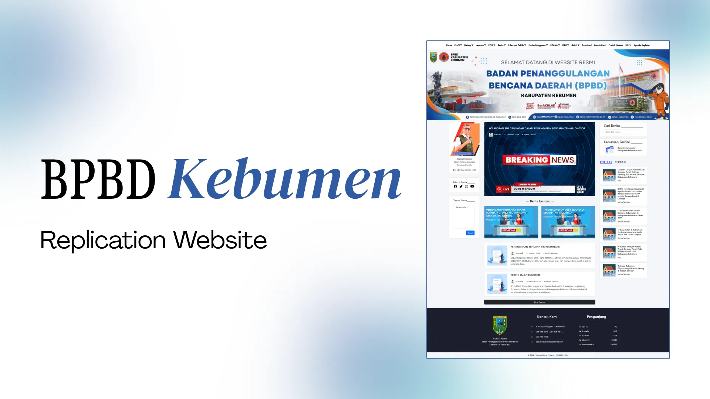
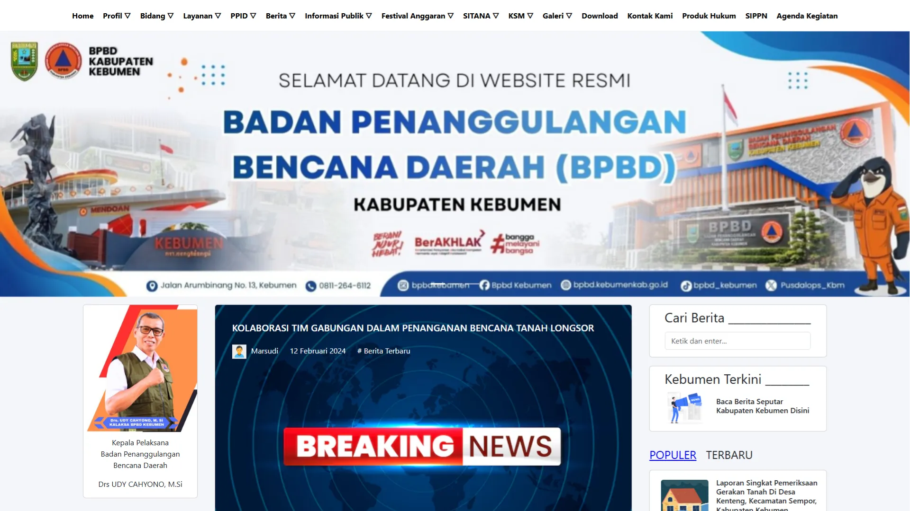
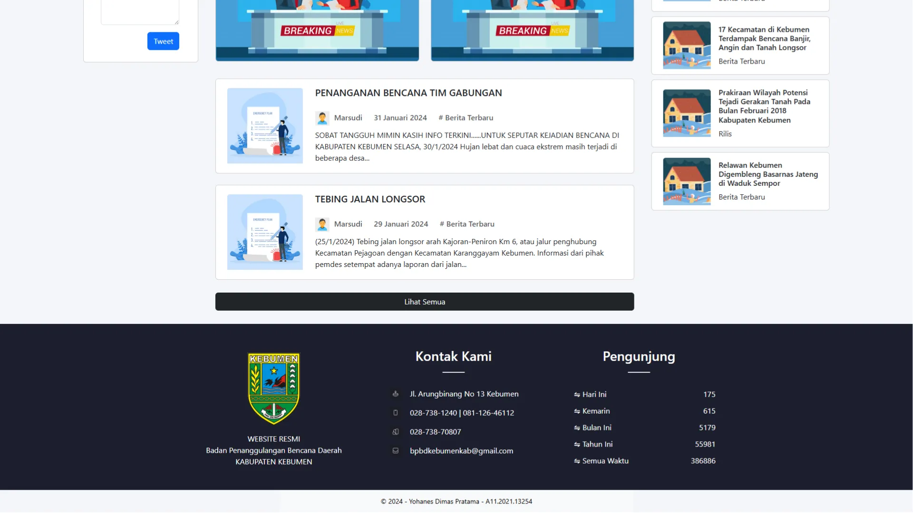

# BPBD Kebumen Website Replication




## Project Overview

BPBD Kebumen Website Replication is a front-end React single-page application that recreates the public portal interface of the Regional Disaster Management Agency of Kebumen Regency (*Badan Penanggulangan Bencana Daerah Kabupaten Kebumen*). The project models a high-density government news and information portal using modular React components and Bootstrap grid primitives. It addresses the challenge of translating a multi-section institutional portal—spanning navigation menus, disaster response announcements, agency leadership identity, interactive feedback forms, and visitor statistics—into maintainable, reusable UI modules without requiring a live backend CMS.

## Key Features

- **Institutional Navigation Bar**: Implements a 16-item horizontal header menu (`NavigationBar`) covering core agency sections (`Home`, `Profil`, `Bidang`, `Layanan`, `PPID`, `Berita`, `Informasi Publik`, `Festival Anggaran`, `SITANA`, `KSM`, `Galeri`, `Download`, `Kontak Kami`, `Produk Hukum`, `SIPPN`, and `Agenda Kegiatan`).
- **Hero Welcome Carousel**: Renders a full-width three-slide image carousel (`MyCarousel`) displaying official BPBD Kebumen welcome and agency banners via React Bootstrap `Carousel`.
- **Three-Column Responsive Content Grid**: Organizes the main portal body (`Content`) into a 2-column left sidebar, flexible center news column, and 3-column right sidebar using React Bootstrap `Container`, `Row`, and `Col`.
- **Tiered Disaster News Feed**: Presents headline news with text-over-image overlays (`BeritaUtama`), two-column secondary disaster reports (`BeritaSekunder`), horizontal article summary cards (`BeritaLainnya`), and a full-width `Lihat Semua` action button (`BtnLihatSemua`).
- **Agency Sidebar & Engagement Widgets**: Combines the Chief Executive profile card (`KepalaPelaksana`), external social media links (`MediaSosial`), and a floating-label suggestion textarea (`TweetSaran`) on the left, paired with a search bar (`SearchBar`), regional news card (`BeritaTerkini`), and `POPULER / TERBARU` feed (`BeritaSamping`) on the right.
- **Multi-Column Institutional Footer**: Displays the Kebumen Regency emblem and agency identity (`IdentitasWeb`), office address and contact channels (`KontakKami`), a parameterized five-row visitor counter table (`StatistikPengunjung`), and a bottom copyright bar (`Copyright`).

## Tech Stack

| Category | Technology | Purpose |
| :--- | :--- | :--- |
| Language | JavaScript (ES6+) | Implements functional React components, JSX templates, and structured news arrays |
| UI Library | React | Powers modular component composition and virtual DOM rendering |
| Component Framework | React Bootstrap | Provides `Navbar`, `Carousel`, `Card`, `Container`, `Row`, `Col`, `Stack`, and `Form` components |
| CSS Framework | Bootstrap | Supplies responsive grid layout, spacing utilities, typography, and card/button styling |
| Styling | CSS3 | Defines custom viewport, background (`#F4F6FA`), and container width rules in `LandingPage.css` and `App.css` |
| Build Tooling | Create React App (`react-scripts`) | Handles local development server, Webpack asset bundling, and production builds |
| Runtime & Package Manager | Node.js & npm | Manages package dependencies and executes application scripts |
| Data Layer | Static In-Memory Data & Props | Supplies news records and visitor counter props directly within client-side modules |

## Screenshots / Preview

### 1. Top Navigation Bar, Hero Carousel & Upper Portal Fold

The upper fold pairs the 16-link white navigation bar with the full-width BPBD Kebumen welcome carousel, establishing agency branding and top-level portal navigation. Directly beneath the slider, the three-column grid introduces the Chief Executive profile card, the primary breaking-news headline overlay, and the right-hand news search and highlight widgets.

### 2. Three-Column News Feed & Sidebar Interaction Widgets

The mid-page layout showcases the left sidebar's social media icon bar and floating-label "Tweet Saran" suggestion box alongside the central disaster news hierarchy. Below the primary landslide collaboration headline, a two-column secondary card row highlights regional incident updates while the right sidebar lists popular and recent disaster bulletins.

### 3. Article List, Action Button & Institutional Footer

The lower section renders horizontal article summary cards (`BeritaLainnya`) with thumbnails, author metadata, and excerpts followed by a full-width "Lihat Semua" button. Anchoring the page, the `#1C1F2E` dark footer consolidates the Kebumen Regency crest, official address and contact details, a five-metric visitor statistics table, and the developer copyright notice.

## Prerequisites

- **Node.js** (v16.x or higher recommended for `react-scripts` 5.0.1 and React 18)
- **npm** (v8.x or higher, included with Node.js)
- **Git** for cloning the repository
- A modern web browser (Chrome, Firefox, Edge, or Safari)

## Installation & Setup

1. Clone the repository to your local machine:
   ```bash
   git clone https://github.com/weztcy/BPBD-Kebumen-Website-Replication.git
   ```

2. Navigate into the project directory:
   ```bash
   cd "BPBD Kebumen Website Replication"
   ```

3. Install all required npm dependencies:
   ```bash
   npm install
   ```

## Usage

After installing dependencies, start the local Create React App development server to preview the replicated portal in your browser.

1. Launch the development server:
   ```bash
   npm start
   ```

2. Open `http://localhost:3000` in your browser if it does not open automatically. The page reloads automatically when source files in `src/` are modified.

3. (Optional) Generate an optimized static production bundle in the `build/` directory:
   ```bash
   npm run build
   ```

## Contributing

Contributions that improve visual fidelity, responsive behavior, or component accessibility are welcome. Follow these steps to contribute:

1. Fork the repository.
2. Create a branch for the change (`git checkout -b feature/your-feature-name`).
3. Make and test the changes locally.
4. Commit and push the branch to your fork.
5. Open a pull request with a clear explanation of your updates.

## License

This project is licensed under the MIT License.
See the [LICENSE](LICENSE) file for details.

## Author & Contact

**Yohanes Dimas Pratama**

- GitHub: [github.com/weztcy](https://github.com/weztcy)
- Portfolio: [yohanesdimas.com](https://yohanesdimas.com)
- LinkedIn: [linkedin.com/in/yohanes-dimas](https://www.linkedin.com/in/yohanes-dimas)
