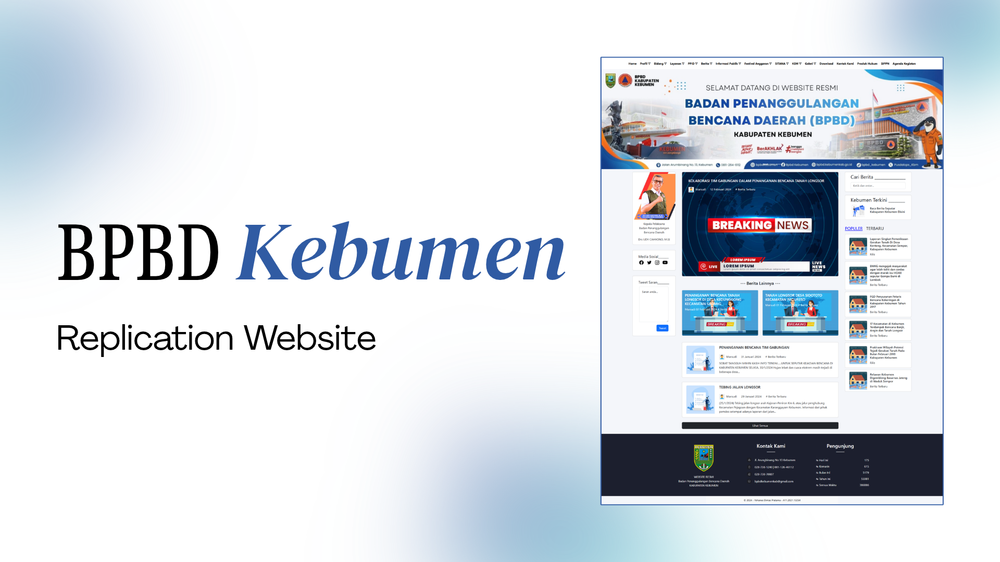

# BPBD Kebumen Website Replication

[](#)
[](#)
[](#)
[](#)
[](#)
[](#)
[](./LICENSE)



**BPBD Kebumen Website Replication** is a responsive, component-driven frontend web replication of the official regional government portal for **BPBD Kebumen** (*Badan Penanggulangan Bencana Daerah Kabupaten Kebumen* / Regional Disaster Management Agency of Kebumen Regency, Central Java, Indonesia). Built with React 18, React-Bootstrap, and Bootstrap 5, the application restructures municipal public information systems into clean, modular, and maintainable user interface components.

Regional government and emergency management agencies rely on continuous, transparent communication to disseminate critical disaster mitigation updates, severe weather advisories, emergency hotline contacts, and public safety announcements. Legacy municipal websites often face structural challenges, including cluttered information hierarchies, rigid layout frameworks, and complex content management backends. This project modernizes the presentation layer of the BPBD Kebumen web portal into reusable React components, providing citizens and emergency response teams with an intuitive, readable, and accessible digital portal.

---

## Features

- **Institutional Header & Navigation**: Multi-section navigation bar reflecting public municipal governance domains, including agency profiles (`Profil`), operational divisions (`Bidang`), emergency public services (`Layanan`), public information disclosure (`PPID`, `Informasi Publik`), budget transparency (`Festival Anggaran`), regional disaster monitoring systems (`SITANA`), and regulatory archives (`Produk Hukum`).
- **Hero Operation Carousel**: Interactive high-resolution image carousel spotlighting field inspections, disaster mitigation operations, and inter-agency community coordination throughout Kebumen Regency.
- **Top Priority Emergency News (`BeritaUtama`)**: Prominent overlay card showcasing breaking disaster management operations—such as joint landslide mitigation efforts with the Department of Public Works and Public Housing (PUPR) and village administrations—accompanied by author attribution, publication date, and thematic category tagging.
- **Secondary Disaster Reports Grid (`BeritaSekunder`)**: Two-column responsive card matrix highlighting concurrent disaster events and mitigation operations across sub-districts (e.g., Sadang and Padureso).
- **Chronological Emergency Feed (`BeritaLainnya`)**: Horizontal news card stream delivering detailed event summaries, infrastructure damage evaluations, and continuous incident reporting.
- **Interactive Multi-Widget Sidebar**:
  - *Disaster Archive Search*: Text input form widget enabling users to filter and search agency announcements and news.
  - *Regional Information Shortcut (`BeritaTerkini`)*: Visual banner directing citizens to regional headlines across Kebumen Regency.
  - *Popular & Recent Updates Switcher (`BeritaSamping`)*: Tabbed sidebar module highlighting trending reports, BMKG earthquake rumor clarifications, drought vulnerability assessments, and Basarnas volunteer training.
- **Agency Leadership Spotlight (`KepalaPelaksana`)**: Dedicated executive profile card presenting the Head of BPBD Kebumen (*Kepala Pelaksana BPBD Kabupaten Kebumen*) with official insignia and credential details.
- **Citizen Feedback & Suggestion Portal (`TweetSaran`)**: Interactive input module providing a citizen feedback channel to submit inquiries, reports, and community recommendations directly to agency administrators.
- **Official Social Channel Integration (`MediaSosial`)**: Verified link hub providing single-click routing to BPBD Kebumen's official presence across Facebook, Twitter/X, Instagram, and YouTube.
- **Institutional Dark Footer & Public Telemetry**:
  - *Official Crest & Regional Identity (`IdentitasWeb`)*: Official emblem of Kabupaten Kebumen and institutional credentials.
  - *Emergency Dispatch Directory (`KontakKami`)*: Complete communication directory listing office address (Jl. Arungbinang No. 13 Kebumen), emergency response telephone lines (`028-738-1240 | 081-126-46112`), facsimile number, and agency email.
  - *Visitor Traffic Telemetry (`StatistikPengunjung`)*: Structured analytics table monitoring visitor volumes across daily, yesterday, monthly, yearly, and cumulative metrics.

---

## Preview & Demo

The application's responsive layout and integrated disaster management components are demonstrated below:


*Full-Page Architecture: Top navigation bar, operational hero slider, executive leadership profile, citizen suggestion module, social channel links, central breaking news stream, secondary sub-district incident grid, sidebar search and trending topics, and full institutional footer with visitor traffic analytics.*

---

## Tech Stack

### Core Frontend & UI Framework

| Technology | Version | Purpose |
| :--- | :--- | :--- |
| **React** | 18.3.1 | Core component-based declarative UI library |
| **React-DOM** | 18.3.1 | DOM renderer for React web application |
| **React-Bootstrap** | 2.10.2 | Accessible Bootstrap components engineered for React state |
| **Bootstrap** | 5.3.3 | Core styling, utility classes, and responsive flexbox grid |
| **JavaScript (ES6+)** | Modern | Application logic, component lifecycle, and state modeling |
| **CSS3** | Modern | Custom stylesheet layers (`App.css`, `LandingPage.css`, `index.css`) |

### Tooling & Runtime Environment

| Tool | Version | Purpose |
| :--- | :--- | :--- |
| **Node.js** | 16.x / 18.x / 20.x | JavaScript runtime environment |
| **npm** | 8.x+ | Package manager and script orchestration |
| **Create React App (react-scripts)** | 5.0.1 | Webpack and Babel development and bundling toolchain |
| **Web Vitals** | 2.1.4 | Real-user performance and frontend telemetry instrumentation |
| **Jest & React Testing Library** | 13.4.0 / 5.17.0 | Component rendering tests and DOM assertion framework |

---

## Prerequisites

Ensure the following runtimes and tools are installed on your workstation:

- **Node.js**: `v16.14.0` or higher (Node `v18.x` or `v20.x` LTS recommended). Verify with:
  ```bash
  node -v
  ```
- **npm**: `v8.0.0` or higher (bundled with Node.js). Verify with:
  ```bash
  npm -v
  ```

---

## Installation & Setup

1. **Clone the Repository**:
   ```bash
   git clone https://github.com/weztcy/BPBD-Kebumen-Website-Replication.git
   ```

2. **Navigate into the Project Root**:
   ```bash
   cd BPBD-Kebumen-Website-Replication
   ```

3. **Install Dependencies**:
   Install all required npm dependencies as defined in `package.json`:
   ```bash
   npm install
   ```

---

## Usage / Running the Project

Start the local development server:

```bash
npm start
```

Once compilation succeeds:
- The development server will launch locally at `http://localhost:3000`.
- The browser will automatically open or refresh when source files inside `src/` are modified.

---

## Available Scripts / Commands

The following npm scripts are configured in `package.json`:

| Command | Purpose |
| :--- | :--- |
| `npm start` | Starts the local Webpack dev server at `http://localhost:3000` with hot-module replacement. |
| `npm run build` | Compiles and optimizes static production bundles into the `build/` directory. |
| `npm test` | Launches the interactive Jest test runner in watch mode. |
| `npm run eject` | Ejects Create React App configuration files (one-way operation; use with caution). |

---

## Testing

The project uses **Jest** and **React Testing Library** for automated component and DOM testing:

```bash
# Run tests interactively in watch mode
npm test

# Run tests once without watch mode (CI mode)
npm test -- --watchAll=false
```

---

## Build & Deployment

### Production Build

To compile and optimize the web application for production deployment:

```bash
npm run build
```

The compiled output will be output to the `build/` folder:
- HTML, JavaScript, and CSS bundles are minified and fingerprinted with cache-busting hashes.
- Assets within the `public/` directory are copied into the production build bundle.

### Static Hosting

The resulting `build/` directory contains purely static files and can be deployed directly to modern static web hosts:
- **Vercel**: Deploy via the Vercel CLI (`vercel`) or by connecting the GitHub repository.
- **Netlify**: Deploy using `netlify deploy --dir=build --prod` or drag-and-drop the `build/` directory in the Netlify Dashboard.
- **GitHub Pages**: Configure static workflow actions or use `gh-pages` to serve from the `build` branch.

---

## Contributing

Contributions, issues, and feature enhancements are welcome. To contribute:

1. Fork the repository on GitHub (`https://github.com/weztcy/BPBD-Kebumen-Website-Replication`).
2. Create a dedicated feature branch:
   ```bash
   git checkout -b feature/component-enhancement
   ```
3. Implement your changes following established React and React-Bootstrap coding standards.
4. Commit your changes with clear, descriptive commit messages:
   ```bash
   git commit -m "feat: enhance responsive sidebar layout"
   ```
5. Push to your forked repository:
   ```bash
   git push origin feature/component-enhancement
   ```
6. Open a Pull Request targeting the `main` branch of this repository.

---

## License

Please see the [LICENSE](./LICENSE) file for the terms and conditions governing the use, modification, and distribution of this project.

## Author & Contact

**Yohanes Dimas Pratama**

- GitHub: [github.com/weztcy](https://github.com/weztcy)
- Portfolio: [dimaspratama.vercel.app](https://dimaspratama.vercel.app)
- LinkedIn: [linkedin.com/in/yohanes-dimas](https://www.linkedin.com/in/yohanes-dimas)

